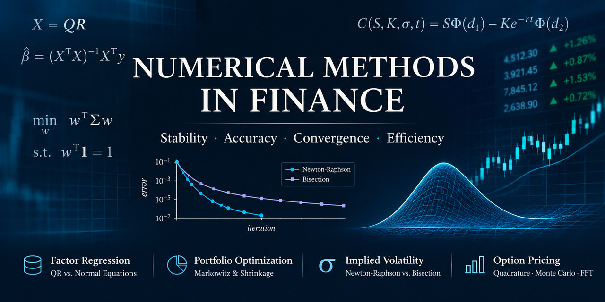

<p align="center">
  
</p>

# Numerical Methods in Finance


# Numerical Methods in Finance

**A comparative study of numerical stability, accuracy, convergence, and computational efficiency in financial applications.**

This project explores how different numerical methods behave when applied to common problems in financial mathematics. Rather than focusing only on obtaining a solution, it examines **when an algorithm is reliable, how accurate it is, and what it costs to compute**.

> **Project status:** In development. The repository structure and Python environment are being prepared; implementations, experiments, and results will be added progressively.

---

## Research objectives

The project addresses four questions:

1. **Numerical stability:** How does matrix conditioning affect least-squares estimation?
2. **Robustness:** How does covariance shrinkage affect portfolio weights and out-of-sample risk?
3. **Convergence:** When do root-finding methods struggle to recover implied volatility?
4. **Efficiency:** How do numerical option-pricing methods compare in accuracy and runtime?

## Modules

| Module | Problem | Methods compared | Main evaluation criteria |
|:--|:--|:--|:--|
| **01 · Factor Regression** | Least-squares estimation | QR decomposition vs. normal equations | Numerical error, conditioning, runtime |
| **02 · Portfolio Optimization** | Minimum-variance portfolios | Sample covariance vs. shrinkage | Conditioning, weight stability, out-of-sample risk |
| **03 · Implied Volatility** | Black–Scholes inversion | Newton–Raphson vs. bisection | Accuracy, convergence, robustness |
| **04 · Option Pricing** | European option valuation | Quadrature vs. Monte Carlo vs. FFT | Pricing error, convergence, computational cost |

Each module will include **reusable Python implementations**, **automated tests**, and **reproducible numerical experiments**.

## Project structure

```text
numerical-finance/
├── src/
│   └── numerical_finance/
│       ├── regression/       # Least-squares methods
│       ├── portfolio/        # Covariance estimation and Markowitz
│       └── options/          # Black–Scholes and option-pricing methods
├── experiments/              # Jupyter notebooks (one per module)
├── tests/                    # Automated tests
├── reports/                  # Technical report and its source
├── figures/                  # Figures generated by experiments
├── pyproject.toml            # Dependencies and package configuration
├── .gitignore
├── LICENSE
└── README.md
```

## Installation

**Requirements:** Python 3.12 and Git.

**1. Clone the repository**

```bash
git clone https://github.com/StoryPlayAI/numerical-finance.git
cd numerical-finance
```

**2. Create and activate a virtual environment (macOS / Linux)**

```bash
python3.12 -m venv .venv
source .venv/bin/activate
```

**3. Install the project and development tools**

```bash
python -m pip install -e ".[dev]"
```

## Running the project

Once the notebooks have been added, launch JupyterLab with:

```bash
jupyter lab
```

Open a notebook in `experiments/` to run its experiments and generate figures.

To run the automated tests as they are added:

```bash
pytest
```

## Experimental approach

For each module, the workflow will be:

1. **Implement** the numerical methods in `src/`.
2. **Validate** the implementations using tests and reference solutions where available.
3. **Experiment** under controlled scenarios in a Jupyter notebook.
4. **Measure** error, stability, convergence, and execution time.
5. **Discuss** the findings and limitations in the technical report.

## Technical report

The planned report, **_Numerical Methods in Finance: A Comparative Study_**, will provide the mathematical background, experimental setup, selected results, and conclusions.

The PDF and editable report source will be published in [`reports/`](reports/) as the modules are completed.

## Technology

**Python · NumPy · SciPy · Pandas · Matplotlib · scikit-learn · JupyterLab · pytest**

## License

This project is distributed under the terms of the [MIT License](LICENSE).
